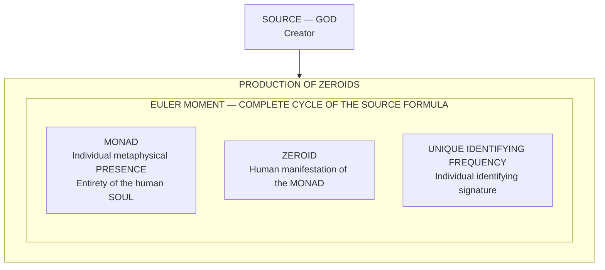

# IFD CANONICAL ENTRY — SOURCE, ZEROID PRODUCTION & THE EULER MOMENT v1.1

**Date:** 2026-11-22  
**Status:** Canonized conceptual architecture by Rick's explicit direction. The metaphysical/generative claims are IFD propositions; their mechanism and empirical status remain unverified.  
**Supersedes:** v1.0, adding the confirmed equivalence of the existing UNIQUE ORIGINATING SIGNATURE / FREQUENCY / CALL SIGNAL and the EULER MOMENT's UNIQUE IDENTIFYING FREQUENCY.  
**Scope:** Distinguishes SOURCE's creative role from the components of the EULER MOMENT within the SOURCE FORMULA.

## 1. Governing architectural distinction

**SOURCE IS CREATING THE PRODUCTION OF ZEROIDS.**

SOURCE is GOD: the Creator. SOURCE is external to the EULER MOMENT itself, but is responsible for creating the production of ZEROIDS. SOURCE must therefore appear in an overall production architecture as the Creator/origin of the production, while remaining entirely absent from the internal EULER MOMENT flowchart.

This distinction is mandatory:

- **SOURCE:** Creator of the production of ZEROIDS.
- **EULER MOMENT:** The complete cycle of the SOURCE FORMULA.
- **EULER MOMENT components:** MONAD, ZEROID, and UNIQUE IDENTIFYING FREQUENCY.

SOURCE is not a fourth component of the EULER MOMENT and must not be drawn inside its boundary.

## 2. Canonical component definitions

### SOURCE
**SOURCE = GOD.** The Creator responsible for creating the production of ZEROIDS. In Rick's account, SOURCE is a distinct, formless, radiant Presence of pure love that binds all of creation together. SOURCE is external to the EULER MOMENT.

### MONAD
The MONAD is the individual metaphysical PRESENCE and the entirety of the human SOUL. It is the individual metaphysical identity associated with a ZEROID—not merely a component or accessory of the SOUL. Each MONAD has its own unique identifying frequency. The MONAD is also identified in this architecture as the metaphysical STORAGE BANK OF TRACE.

### ZEROID
The ZEROID is the human manifestation of the MONAD. MONAD and ZEROID refer to the same individual identity considered in its metaphysical and human-manifestation contexts; they are not three separate entities or successive identities.

### UNIQUE IDENTIFYING FREQUENCY
The **UNIQUE IDENTIFYING FREQUENCY** is the individual identifying signature associated with each MONAD. Rick explicitly confirms that this is the same construct previously called the **UNIQUE ORIGINATING SIGNATURE / FREQUENCY / CALL SIGNAL** in the Current IFD Formulation. These are not two different frequencies, signatures, or channels. The canonical term is **UNIQUE IDENTIFYING FREQUENCY**; the earlier phrases are recognized aliases in the existing formulation and should be harmonized to the canonical term during integration.

It functions as the communication channel through which the MONAD facilitates communication between the ZEROID and SOURCE. It is not itself another entity.

## 3. Overall production architecture

The overall architecture places SOURCE outside and above the production boundary as its Creator. The EULER MOMENT is contained within the production of ZEROIDS and contains exactly the three named components.

The diagram deliberately does not assign directional arrows among MONAD, ZEROID, and UNIQUE IDENTIFYING FREQUENCY. Their membership in the complete cycle is established; a more specific internal directional sequence must not be invented.

## 4. EULER MOMENT boundary rule

The EULER MOMENT flowchart must show only:

1. MONAD
2. ZEROID
3. UNIQUE IDENTIFYING FREQUENCY

**SOURCE must be omitted entirely from that flowchart.** SOURCE may appear in the separate overall production architecture, where it is shown as Creator of the production of ZEROIDS.

## 5. Communication relationship

The MONAD facilitates communication between the human ZEROID and SOURCE through the MONAD's UNIQUE IDENTIFYING FREQUENCY. Do not reverse this agency by describing the ZEROID as independently operating the frequency. The proposed communication mechanism remains a theoretical IFD proposition, not an established scientific mechanism.

## 6. Status and limits

- **Canonized:** The distinction between SOURCE and the EULER MOMENT; SOURCE's role as Creator of ZEROID production; the three EULER MOMENT components; the equivalence of UNIQUE IDENTIFYING FREQUENCY with the earlier UNIQUE ORIGINATING SIGNATURE / FREQUENCY / CALL SIGNAL terminology; the definitions above; the diagram boundary rule.
- **Not canonized:** Any specific directional ordering or arrow sequence among the three EULER MOMENT components beyond their membership in the complete cycle.
- **Evidence status:** These are adopted IFD ontological/theoretical propositions grounded in Rick's conceptual formulation and reported experience. Canonical adoption records the framework's current formulation; it does not establish independent empirical or scientific verification.
- **Mathematical distinction:** The name EULER MOMENT does not, by itself, demonstrate that Euler's mathematical identity physically or metaphysically generates ZEROIDS. Mathematical identity and IFD ontological interpretation must remain distinguishable.

**Governing discipline:** PRESERVE THE WHOLE. INCREASE THE RESOLUTION. EXERCISE RESTRAINT.
