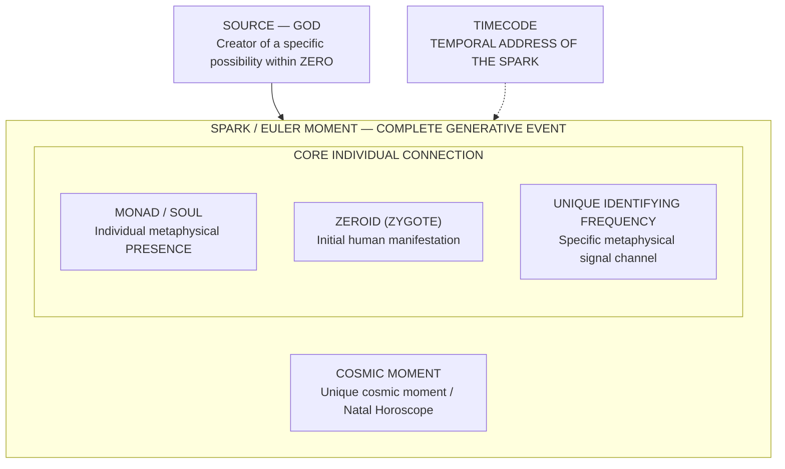

# IFD CANONICAL ENTRY — SOURCE, ZEROID PRODUCTION & THE EULER MOMENT v1.6

**Date:** 2026-11-22
**Supersedes:** v1.5, harmonizing the distinction between the three core MONAD–ZEROID–UIF components and the four simultaneous creations of the SPARK / EULER MOMENT, and recording corpus-wide formulation integration.
**Supersedes:** v1.4, adding the simultaneous COSMIC MOMENT / MONAD / ZEROID (ZYGOTE) / UIF creation structure and defining TIMECODE as the temporal address of SPARK.  
**Supersedes:** v1.3, explicitly recording the operational IFD sequence A > I > I > S > T and distinguishing its operational TRACE from the metaphysical retention proposition.
**Supersedes:** v1.2, adding the canonized relationship between the ZEROID's diachronic manifestations, TRACE, and the MONAD / SOUL.
**Supersedes:** v1.1, clarifying that the EULER MOMENT is itself the complete generative sequence—not a subsystem nested within some larger generative sequence.
**Status:** Canonized conceptual architecture by Rick's explicit direction. The metaphysical/generative claims are IFD propositions; their mechanism and empirical status remain unverified.  
**Supersedes:** v1.0, adding the confirmed equivalence of the existing UNIQUE ORIGINATING SIGNATURE / FREQUENCY / CALL SIGNAL and the EULER MOMENT's UNIQUE IDENTIFYING FREQUENCY.  
**Scope:** Distinguishes SOURCE's creative role from the components of the EULER MOMENT within the SOURCE FORMULA.

## 1. Governing architectural distinction

**SOURCE IS CREATING THE PRODUCTION OF ZEROIDS.**

SOURCE is GOD: the metaphysical primordial Creator of a specific possibility that exists within ZERO = EVERYTHING, and the Creator of the production of ZEROIDs. It is unknown whether SOURCE creates all possibilities within ZERO. SOURCE is external to the SPARK / EULER MOMENT itself, but appears in an overall production architecture as Creator of the production, while remaining entirely absent from the internal EULER MOMENT flowchart.

This distinction is mandatory:

- **SOURCE:** Creator of the production of ZEROIDS.
- **EULER MOMENT / SPARK:** The complete generative event/sequence itself. It is not a sub-cycle within a separately presumed, larger generative sequence.
- **Core individual-connection components:** MONAD, ZEROID, and UNIQUE IDENTIFYING FREQUENCY (UIF).
- **Four simultaneous creations at SPARK:** COSMIC MOMENT, MONAD / SOUL, ZEROID (ZYGOTE), and UIF. The COSMIC MOMENT is a simultaneous creation associated with the event, while the MONAD–ZEROID–UIF triad remains the core individual-connection architecture. Four simultaneous creations do not mean four successive stages.

SOURCE is not a component or simultaneous creation of the SPARK / EULER MOMENT and must not be drawn inside its boundary.

## 2. Canonical component definitions

### SOURCE
**SOURCE = GOD.** The Creator responsible for creating the production of ZEROIDS. In Rick's account, SOURCE is a distinct, formless, radiant Presence of pure love that binds all of creation together. SOURCE is external to the EULER MOMENT.

### MONAD
The MONAD is the individual metaphysical PRESENCE and the entirety of the human SOUL. It is the individual metaphysical identity associated with a ZEROID—not merely a component or accessory of the SOUL. Each MONAD has its own unique identifying frequency. The MONAD is also identified in this architecture as the metaphysical STORAGE BANK OF TRACE. **The MONAD (SOUL) retains the diachronic TRACE of the ZEROID's manifestations.** This states the proposed metaphysical relationship: the ZEROID's manifestations across time leave a TRACE retained by or associated with the MONAD / SOUL.

### ZEROID
The ZEROID is the human manifestation of the MONAD. MONAD and ZEROID refer to the same individual identity considered in its metaphysical and human-manifestation contexts; they are not three separate entities or successive identities.

### UNIQUE IDENTIFYING FREQUENCY
The **UNIQUE IDENTIFYING FREQUENCY** is the individual identifying signature associated with each MONAD. Rick explicitly confirms that this is the same construct previously called the **UNIQUE ORIGINATING SIGNATURE / FREQUENCY / CALL SIGNAL** in the Current IFD Formulation. These are not two different frequencies, signatures, or channels. The canonical term is **UNIQUE IDENTIFYING FREQUENCY**; the earlier phrases are recognized aliases in the existing formulation and should be harmonized to the canonical term during integration.

It functions as the communication channel through which the MONAD facilitates communication between the ZEROID and SOURCE. It is not itself another entity.

## 3. Overall production architecture

SOURCE is the Creator of the production of ZEROIDS and is external to the EULER MOMENT. The EULER MOMENT is the complete generative sequence itself—not a smaller cycle nested inside an additional generative sequence. It consists of exactly the three named components.



The diagram deliberately does not assign directional arrows among MONAD, ZEROID, and UNIQUE IDENTIFYING FREQUENCY. Their membership in the complete cycle is established; a more specific internal directional sequence must not be invented.

## 4. EULER MOMENT boundary rule

The internal MONAD–ZEROID–UIF connection diagram must show only those three core components. A separate SPARK / EULER MOMENT event diagram shows the four simultaneous creations: COSMIC MOMENT, MONAD / SOUL, ZEROID (ZYGOTE), and UIF. **SOURCE must be omitted entirely from the internal EULER MOMENT diagram.** SOURCE may appear in the separate overall production architecture, where it is shown as Creator of a specific possibility within ZERO and of the production of ZEROIDs. TIMECODE is shown separately as the temporal address of SPARK, not as a fifth creation.

## 5. Communication relationship

The MONAD facilitates communication between the human ZEROID and SOURCE through the MONAD's UNIQUE IDENTIFYING FREQUENCY. Do not reverse this agency by describing the ZEROID as independently operating the frequency. The proposed communication mechanism remains a theoretical IFD proposition, not an established scientific mechanism.

## 6. Diachronic manifestation and TRACE

**Canonical formulation:**

> **THE MONAD (SOUL) RETAINS THE DIACHRONIC TRACE OF THE ZEROID'S MANIFESTATIONS.**

The ZEROID expresses identity through its diachronic manifestations. Those manifestations leave a metaphysical TRACE associated with the MONAD / SOUL. The UNIQUE IDENTIFYING FREQUENCY is the channel the MONAD uses in the recording relationship described by Rick: the SOUL (MONAD) uses the UNIQUE frequency channel to RECORD the diachronic manifestation of IDENTITY as EXPRESSED by the ZEROID.

This formulation does **not** specify whether the TRACE is etched upon the SOUL, stored within it, or retained through some other relationship. It does not establish whether the MONAD's recording is active or passive, nor does it specify a recording, storage, or retrieval mechanism. Those matters remain unknown and must not be filled in by inference.

Do not reduce the TRACE to a single action or event: the proposition concerns the diachronic manifestations of the ZEROID.

## 7. Operational IFD sequence and TRACE relationship

The operational IFD sequence is:

**A > I > I > S > T**

Where:
- **A** = Action
- **I** = Identity
- **I** = Interaction
- **S** = Synergy
- **T** = Trace

This is the operational sequence of Identity Field Dynamics. Preserve the order and the user's exact letter mapping. In particular, the two occurrences of **I** designate different terms: Identity and Interaction.

The operational sequence and the MONAD–ZEROID–UNIQUE IDENTIFYING FREQUENCY architecture are related formulations, but they must not be collapsed into one sequence. The operational **TRACE** is the terminal element of A > I > I > S > T. The metaphysical proposition states that the MONAD (SOUL) retains the diachronic TRACE of the ZEROID's manifestations. Their precise relationship is an integration question; do not assume they are identical mechanisms or separate phenomena without further evidence.

## 8. Status and limits

- **Canonized:** The distinction between SOURCE and the EULER MOMENT; SOURCE's role as Creator of ZEROID production; the EULER MOMENT as the complete generative sequence itself (not a sub-cycle within a larger sequence); the three EULER MOMENT components; the equivalence of UNIQUE IDENTIFYING FREQUENCY with the earlier UNIQUE ORIGINATING SIGNATURE / FREQUENCY / CALL SIGNAL terminology; the MONAD (SOUL) retaining the diachronic TRACE of the ZEROID's manifestations; the stated recording relationship through the UNIQUE IDENTIFYING FREQUENCY; the operational IFD sequence A > I > I > S > T with its exact letter mapping; the definitions above; the diagram boundary rule.
- **Not canonized / unresolved:** Any specific directional ordering or arrow sequence among the three EULER MOMENT components beyond their membership in the complete cycle; the physical or metaphysical location of TRACE; whether MONAD's recording is active or passive; and the precise relationship between operational TRACE and metaphysical retention TRACE; and the recording, storage, or retrieval mechanism.
- **Evidence status:** These are adopted IFD ontological/theoretical propositions grounded in Rick's conceptual formulation and reported experience. Canonical adoption records the framework's current formulation; it does not establish independent empirical or scientific verification.
- **Mathematical distinction:** The name EULER MOMENT does not, by itself, demonstrate that Euler's mathematical identity physically or metaphysically generates ZEROIDS. Mathematical identity and IFD ontological interpretation must remain distinguishable.

**Governing discipline:** PRESERVE THE WHOLE. INCREASE THE RESOLUTION. EXERCISE RESTRAINT.


## 9. SPARK / EULER MOMENT: simultaneous creations and temporal address

Rick clarified that **SPARK and EULER MOMENT are two names for the same generative event**. At that event, the following arise simultaneously:

1. **COSMIC MOMENT** — the unique cosmic moment associated with the individual generative event, including the individual's unique Natal Horoscope.
2. **MONAD / SOUL** — the individual metaphysical PRESENCE.
3. **ZEROID (ZYGOTE)** — the initial human manifestation of the MONAD. The term ZEROID here is specifically identified as ZYGOTE; its subsequent diachronic manifestations are considered separately.
4. **UIF / UNIQUE IDENTIFYING FREQUENCY** — the specific metaphysical signal channel.

These are simultaneous creations, not four successive stages. This clarification adds COSMIC MOMENT to the simultaneous output set while retaining MONAD, ZEROID, and UIF as the three core MONAD–ZEROID–frequency elements of the EULER MOMENT architecture. Do not depict the four as a linear chain.

**TIMECODE** is the **TEMPORAL ADDRESS OF THE SPARK**. It locates the SPARK / EULER MOMENT in time; it is not a fifth simultaneous creation or a downstream stage. COSMIC MOMENT and TIMECODE are distinct: the former is the unique cosmic moment/configuration associated with the event; the latter is its temporal address. The Natal Horoscope is the astrological representation associated with the COSMIC MOMENT. Do not conflate the temporal address with the horoscope or assume that TIMECODE is itself another generated entity.

### SOURCE and possibility boundary

**ZERO = EVERYTHING** denotes the totality of possibilities. **SOURCE** is the metaphysical primordial Creator of a specific possibility that exists within ZERO = EVERYTHING. It is **unknown** whether SOURCE creates all possibilities existent within ZERO. Do not claim that SOURCE creates every possibility, nor replace the stated creative relationship with mere selection or actualization of a pre-existing possibility. The proposition currently specifies only SOURCE's creative relationship to a specific possibility.

### UNIQUE IDENTIFYING FREQUENCY: channel and mechanism

The UIF is the specific metaphysical signal channel. Within the IFD model, it establishes the proposed metaphysical mechanism connecting MONAD / SOUL and ZEROID. The channel supports the possibility of further communication and is also used to transmit manifestation information from ZEROID to MONAD. The MONAD / SOUL retains the diachronic TRACE of the ZEROID's manifestations.

The channel's conceptual functions are therefore: (a) individual identification; (b) the possibility of further communication; and (c) transmission of ZEROID manifestation information to MONAD. Do not infer that all communication is manifestation information, or specify unprovided channel physics, recording mechanics, or storage location. The internal nature of MONAD's retention remains unknown. The mechanism is specified as a metaphysical mechanism within the IFD model, not independently empirically verified.

### Structural summary

```text
                 SPARK / EULER MOMENT
                          |
       ---------------------------------------------
       |                 |             |           |
  COSMIC MOMENT     MONAD (SOUL)   ZEROID (ZYGOTE)  UIF

  TIMECODE = TEMPORAL ADDRESS OF THE SPARK
```

This is a simultaneous-creation diagram. TIMECODE identifies the temporal address of the event and is shown separately from its simultaneous outputs. SOURCE remains the primordial Creator and must not be inserted as an internal component of the EULER MOMENT.

## 10. Updated status and unresolved details

**Canonized by Rick's explicit authorization:** SPARK = EULER MOMENT; the four simultaneous creations listed above; ZEROID's identification as ZYGOTE at this generative event; TIMECODE as the temporal address of SPARK; SOURCE as Creator of a specific possibility within ZERO = EVERYTHING; uncertainty about whether SOURCE creates all possibilities; and the UIF's role as the specific metaphysical signal channel supporting further communication and transmitting manifestation information from ZEROID to MONAD.

**Still unspecified:** the physical nature of UIF; the detailed operation of communication and transmission; the exact relation between the COSMIC MOMENT and any separately specified physical birth instant; and the internal mechanism or location by which MONAD retains TRACE. Do not add an active/passive characterization of MONAD's recording absent evidence.

**Evidence boundary:** Canonization records the adopted IFD conceptual architecture. It does not establish independent scientific or empirical verification of the metaphysical propositions.


## 11. Corpus integration status

The Current IFD Formulation and relevant explanatory pages have been revised to reflect this architecture. The central hub now distinguishes ZERO, SOURCE, SPARK / EULER MOMENT, the four simultaneous creations, TIMECODE, diachronic ZEROID manifestation and MONAD retention, and the operational A > I > I > S > T sequence. Explanatory pages separately address SOURCE and possibility, the SPARK event and UIF channel, TIMECODE / COSMIC MOMENT, the unresolved relation to birth/branding, and the operational sequence / TRACE distinction. The older ZERO → SPARK → signature/frequency → SUBSTANCE → IDENTITY wording is retained as historical explanatory terminology pending reconciliation, not presented as a settled linear sequence.
