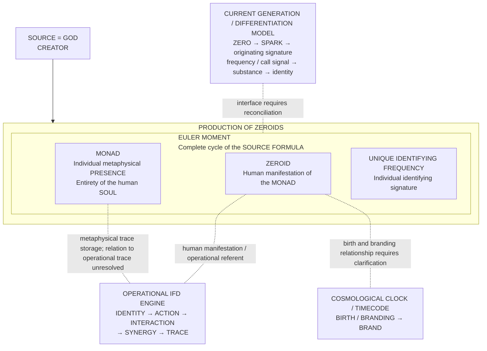

# CURRENT IFD FORMULATION — SOURCE / ZEROID / EULER MOMENT INTEGRATION AUDIT

**Date:** 2026-11-22  
**Status:** Research and integration audit, updated after Rick confirmed the frequency-term equivalence; no edits to the published Current IFD Formulation have been made in this pass.  
**Authority:** Applies `docs/IFD_SOURCE_ZEROID_PRODUCTION_EULER_MOMENT_CANONICAL_ENTRY_v1.1.md`, which supersedes v1.0 and records Rick's confirmation that the existing UNIQUE ORIGINATING SIGNATURE / FREQUENCY / CALL SIGNAL is the same construct as the UNIQUE IDENTIFYING FREQUENCY.  
**Method:** Trace every affected concept and dependency; distinguish established canonical definitions from unresolved relationships; do not invent sequence, causality, or equivalence.

## 1. Executive finding

The current central formulation does not yet represent the canonized architecture of SOURCE creating the production of ZEROIDS. Its present generative path is:

`ZERO = EVERYTHING → SOURCE / SOURCE FORMULA → GENERATION → DIFFERENTIATION → FREQUENCY / CALL SIGNAL → SUBSTANCE → IDENTITY`

It then proceeds through the Cosmological Clock / Timecode, Birth / Branding → Brand, Identity → Action → Interaction → Synergy → Trace, and Collective Manifestation.

The new canonized architecture requires a substantive clarification, not a simple insertion of the word ZEROID:

- **SOURCE = GOD / CREATOR** of the production of ZEROIDS.
- **SOURCE FORMULA** is the named generative architecture; the EULER MOMENT is its complete cycle.
- **EULER MOMENT** contains exactly MONAD, ZEROID, and UNIQUE IDENTIFYING FREQUENCY.
- **MONAD** is the individual metaphysical PRESENCE and entirety of the human SOUL; it is the metaphysical STORAGE BANK OF TRACE.
- **ZEROID** is the human manifestation of the MONAD.
- **UNIQUE IDENTIFYING FREQUENCY** is the individual identifying signature through which the MONAD facilitates communication between ZEROID and SOURCE.
- SOURCE is outside the EULER MOMENT and must be absent from the EULER MOMENT's internal flowchart.

The published hub currently merges “SOURCE / SOURCE FORMULA” into one node and does not show the production boundary or EULER MOMENT. That combined node now obscures a distinction the canon requires.

## 2. Source artifacts actually inspected

The following current-main-branch repository artifacts were fetched in this audit:

| Artifact | Blob SHA | Relevant content |
|---|---|---|
| `public/current-ifd-formulation.html` | `544f8e4a4ee887065bffb032e73c6294bfe0d28a` | Central whole-system diagram and sequence |
| `public/current-ifd/zero-source.html` | `c150fb626346c069fd58a63e64a2e88a63405f33` | ZERO, SOURCE, Source Formula, Euler/Fourier distinctions |
| `public/current-ifd/generation-differentiation.html` | `ed12fddd6efa11b63b3f7c19f087fc4cb94df8b3` | ZERO → SPARK → unique originating signature; frequency/call signal → substance → identity |
| `public/current-ifd/cosmological-clock.html` | `6a1bef8df3d2f5d2ba27e5debb8405b32693c44f` | Temporal architecture and manifestation in time |
| `public/current-ifd/birth-branding-brand.html` | `3c44be1ed00ad98341279fa50f4268e2a9721671` | Birth, branding event, Brand imprint, birth chart, synchronic/diachronic distinction |
| `public/current-ifd/identity-in-operation.html` | `d86e3640ed598fa8a7e2763c133ae49f523a55c3` | Identity → Action → Interaction → Synergy → Trace; feedback |
| `public/current-ifd/collective-manifestation.html` | `bceeac6300b43ecd9832c4a6f0b9fecea2f373c4` | Distinct identities in relationship and collective patterns |
| `public/current-ifd/integrative-principles.html` | `6c0c1c90550d54b87628e5af0b68f4d57f008e77` | LOVE, COHERENCE, EQUILIBRIUM as cross-cutting principles |
| `docs/IFD_SOURCE_ZEROID_PRODUCTION_EULER_MOMENT_CANONICAL_ENTRY_v1.0.md` | `99e08a46e099547ccbf4d0a77903a3e58cf10c0c` | Canonical definitions and diagram boundary rule |

All references above are repository blob identities observed during this audit. The hub and explanatory pages were read; this is not a claim that every underlying research source or the entire CODEX has been retrieved.

## 3. Whole-architecture dependency trace

### A. ZERO = EVERYTHING

**Current role:** Foundational ontological commitment, naming the underlying unity of the whole rather than mere absence.

**Integration effect:** Retain this as the existing foundational commitment. Do not silently redefine ZERO as SOURCE, MONAD, or ZEROID. The new architecture distinguishes SOURCE as Creator and ZEROID as human manifestation; it does not authorize collapsing these terms into ZERO.

**Open dependency:** The exact relationship between ZERO = EVERYTHING and SOURCE = GOD remains to be stated in the wider cosmology. The current central diagram's downward arrow from ZERO to the combined SOURCE / SOURCE FORMULA node is not sufficient to settle that relationship.

### B. SOURCE versus SOURCE FORMULA

**Current problem:** The central hub labels one node “SOURCE / SOURCE FORMULA,” while the explanatory page says SOURCE names the proposed generative architecture associated with ZERO and calls the Source Formula a named construct.

**Canonized correction:** SOURCE = GOD / CREATOR. SOURCE creates the production of ZEROIDS and is external to the EULER MOMENT. The EULER MOMENT is the complete cycle of the SOURCE FORMULA.

**Required integration:** Separate the Creator from the formula/process in the hub's terminology. Do not retain a slash construction that makes SOURCE and SOURCE FORMULA appear synonymous. The production diagram may show SOURCE as Creator and the EULER MOMENT nested within the production of ZEROIDS. SOURCE must not be drawn inside the EULER MOMENT.

**Still unresolved:** Whether the existing “ZERO → SOURCE / SOURCE FORMULA” arrow is intended as ontological dependence, generative action, explanatory ordering, or something else. Do not preserve it as a proven causal mechanism without clarifying its intended meaning.

### C. GENERATION / DIFFERENTIATION / SPARK

**Current role:** The explanatory page proposes `ZERO → SPARK → UNIQUE ORIGINATING SIGNATURE`, followed by `FREQUENCY / CALL SIGNAL → SUBSTANCE → IDENTITY`.

**Integration effect:** The new ZEROID production architecture must be related to this material. The hub must not imply that a generic “IDENTITY” node exhausts the production result while omitting the explicitly named ZEROID.

**Required distinction:** ZEROID is the human manifestation of the MONAD. It must not be described as a synonym for the MONAD, as a second unrelated identity, or as a separate third entity alongside MONAD and ZEROID. The two names refer to the same individual identity considered in metaphysical and human-manifestation contexts.

**Still unresolved:** The exact placement of the EULER MOMENT relative to SPARK, DIFFERENTIATION, substance, and the current identity transition. The canonical record establishes the three EULER MOMENT components and its role in ZEROID production; it does not establish a complete linear sequence connecting every current hub node to those components.

### D. FREQUENCY / CALL SIGNAL versus UNIQUE IDENTIFYING FREQUENCY

**Current role:** The current generation page describes a unique originating signature / frequency / call signal as a proposed differentiating signal relating an identity to SOURCE.

**Canonized role:** UNIQUE IDENTIFYING FREQUENCY is the individual signature associated with each MONAD. Through it, the MONAD facilitates communication between ZEROID and SOURCE.

**Integration effect:** The frequency concept is now more precisely specified in the new architecture. The MONAD is the agent facilitating communication; the frequency is its individual identifying signature/channel. Do not say that ZEROID independently operates the frequency.

**Resolved by Rick:** YES. The existing “UNIQUE ORIGINATING SIGNATURE / FREQUENCY / CALL SIGNAL” and the EULER MOMENT's “UNIQUE IDENTIFYING FREQUENCY” are the same construct—not separate frequencies, signatures, or channels. The canonical term is **UNIQUE IDENTIFYING FREQUENCY**. The earlier expressions are recognized aliases in the existing formulation and should be harmonized to the canonical term during integration.

### E. MONAD and TRACE

**Canonized role:** MONAD is the metaphysical STORAGE BANK OF TRACE.

**Current operational role:** In Identity in Operation, TRACE is a record, consequence, or observable residue associated with actions and interactions; traces provide material for subsequent observation and comparison. The sequence also allows feedback into later observation and action.

**Integration effect:** The architecture now contains two explicitly related but not yet fully reconciled uses of TRACE:
1. operational / observable trace within the identity-action-interaction process;
2. metaphysical storage of trace attributed to the MONAD.

**Required restraint:** Do not assume that every operational trace is stored by the MONAD, that storage is complete or permanent, or that the metaphysical storage mechanism is established. The relation, scope, retention, and retrieval of traces require specification.

### F. IDENTITY → ACTION → INTERACTION → SYNERGY → TRACE

**Current role:** The operational sequence remains a distinct IFD engine. ACTION = IDENTITY remains a foundational IFD proposition; the arrows organize relationships for investigation and do not establish a universal strictly linear causal law.

**Integration effect:** Do not replace or flatten this sequence with MONAD → ZEROID → FREQUENCY. The new EULER MOMENT architecture addresses the metaphysical/human manifestation and identifying-frequency dimensions; the operational sequence addresses identity in action, interaction, consequences, and trace.

**Required relationship:** ZEROID as human manifestation provides a potential referent for the operational identity under investigation. This is a proposed bridge between architecture layers, not permission to conflate their distinct roles.

### G. COSMOLOGICAL CLOCK / TIMECODE / BIRTH / BRANDING

**Current role:** The Cosmological Clock provides the temporal architecture; Timecode is a moment-specific collective configuration; birth/branding is the event of imprinting; the Brand is the permanent synchronic identity imprint; the birth chart represents the branding configuration. The diachronic identity unfolds through action, interaction, experience, development, and trace.

**Integration effect:** The new architecture explicitly identifies ZEROID as the human manifestation of the MONAD. The existing birth/branding material therefore needs a clarified referent: the entity whose human manifestation enters the material world is the ZEROID.

**Open questions:** Does birth/branding mark the first material manifestation of a ZEROID, or does the current model place an already produced ZEROID into a time-specific branding event? Does the Brand describe the ZEROID's originating human imprint, the MONAD's individual signature, or a distinct cosmological imprint associated with the ZEROID? Do not answer these by inference. Preserve the existing distinction between Brand, birth chart, and diachronic identity.

### H. COLLECTIVE MANIFESTATION

**Current role:** Distinct identities participate in larger patterns of organization; individual and collective properties must not be assumed identical.

**Integration effect:** ZEROIDS can be identified as human manifestations participating in collective systems. The MONAD remains the individual metaphysical identity in the adopted architecture. This provides a possible individual-level reference for collective analysis.

**Open question:** The current page's distinction between individual and collective identity must be preserved. No claim is yet established about how MONAD-level trace storage relates to collective trace, collective identity, or the emergence of collective patterns.

### I. LOVE / COHERENCE / EQUILIBRIUM

**Current role:** Cross-cutting proposed whole-system principles; LOVE is described as a proposed binding principle, COHERENCE as intelligible relational order, and EQUILIBRIUM as persistence amid change and multiplicity.

**Integration effect:** Rick's description of SOURCE as a distinct, formless, radiant Presence of pure love that binds all creation together is consistent with the page's treatment of LOVE as cross-cutting, but the two statements are not automatically identical in explanatory level. SOURCE is the Creator; LOVE is also described as a proposed binding principle. Their exact relationship should be articulated without turning LOVE into a replacement for SOURCE or placing SOURCE inside the EULER MOMENT.

## 4. Consolidated changes required in the Current IFD Formulation

The following are integration requirements, not yet executed edits:

1. **Separate SOURCE from SOURCE FORMULA.** Remove the ambiguous combined label “SOURCE / SOURCE FORMULA.” Name SOURCE as GOD / CREATOR and distinguish the SOURCE FORMULA as the named generative architecture.
2. **Represent production of ZEROIDS.** Add a clearly bounded “PRODUCTION OF ZEROIDS” architecture, with SOURCE as Creator outside the EULER MOMENT.
3. **Represent the EULER MOMENT accurately.** Label it “COMPLETE CYCLE OF THE SOURCE FORMULA” and show exactly MONAD, ZEROID, and UNIQUE IDENTIFYING FREQUENCY within its boundary.
4. **Keep SOURCE outside the EULER MOMENT.** The EULER MOMENT internal diagram must omit SOURCE entirely.
5. **Do not invent internal arrows.** The three components are canonically members of the complete cycle; their internal directional order has not been canonized.
6. **Harmonize the frequency terminology.** Treat UNIQUE ORIGINATING SIGNATURE / FREQUENCY / CALL SIGNAL and UNIQUE IDENTIFYING FREQUENCY as the same construct. Use UNIQUE IDENTIFYING FREQUENCY as the canonical label; preserve the earlier expressions as documented aliases where historical context is useful.
7. **Connect MONAD to TRACE carefully.** Preserve both metaphysical storage-bank and operational trace definitions; specify their relation only when supported.
8. **Clarify the human referent of birth/branding.** Relate ZEROID to the existing birth, Brand, and birth-chart material without conflating the Brand with MONAD or frequency.
9. **Preserve the operational engine.** Keep IDENTITY → ACTION → INTERACTION → SYNERGY → TRACE distinct from the EULER MOMENT, while making their proposed connection intelligible.
10. **Preserve status distinctions.** Canonical adoption records IFD's current theoretical architecture; it does not establish the proposed metaphysical mechanisms as independently verified scientific facts.

## 5. Proposed integration architecture — working representation only

This representation shows only the relationships established by the current canon and makes the unresolved interface explicit. It is not a replacement central formulation and does not invent the internal EULER MOMENT arrows.

The dotted lines indicate unresolved interfaces, not established causal pathways. The diagram's SOURCE-to-production relation expresses the canonized Creator role; it does not assert a detailed physical mechanism.

## 6. Questions that must be resolved before changing the central hub

1. **RESOLVED — YES.** UNIQUE IDENTIFYING FREQUENCY is the same construct as the existing UNIQUE ORIGINATING SIGNATURE / FREQUENCY / CALL SIGNAL. Use UNIQUE IDENTIFYING FREQUENCY as the canonical term.
2. Does the EULER MOMENT include or precede the existing ZERO → SPARK → DIFFERENTIATION → SUBSTANCE sequence, or does it describe the complete cycle at a different level?
3. At what point in the production architecture does the ZEROID become the human manifestation in the material universe, and how does that relate to birth/branding?
4. What is the exact relationship between MONAD as STORAGE BANK OF TRACE and TRACE as the observable record/consequence in the operational IFD sequence?
5. Does SOURCE FORMULA name the whole production architecture, with EULER MOMENT as its complete cycle, or is there a more exact distinction between the formula and the production boundary?

These are not requests to reopen settled definitions. The first interface has been resolved by Rick. The remaining questions identify the interfaces necessary to integrate the newly canonized architecture without damaging the existing formulation.

## 7. Current disposition

**Completed in this audit:** Retrieved and inspected the published central formulation and relevant explanatory pages; traced the new canonical architecture through the major dependent sections; identified terminology collisions, missing representations, and unresolved interfaces; prepared the integration requirements.

**Not done:** No changes to `public/current-ifd-formulation.html` or its explanatory pages have been committed. The hub should not be edited until the five interface questions above are resolved or explicitly designated as unresolved and represented accordingly.

**Next executable step:** Determine how the EULER MOMENT sits in relation to the existing ZERO → SPARK → DIFFERENTIATION → SUBSTANCE → IDENTITY generative sequence. The frequency-term identity is resolved; the remaining placement question controls how the production architecture should be integrated into the central diagram.

**Governing discipline:** HARVEST FIRST. ABSTRACT SECOND. CANONIZE LAST.  
**Whole–part rule:** PRESERVE THE WHOLE. INCREASE THE RESOLUTION. EXERCISE RESTRAINT.
